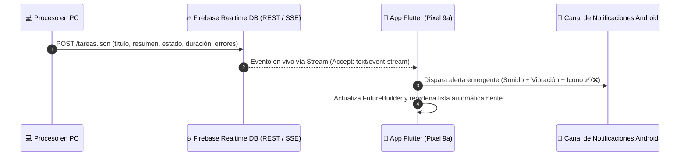

<div align="center">

# 🔔 Tareas Antigravity — Realtime Mobile Monitor (Flutter & Firebase)
### **Monitorización en Tiempo Real de Procesos y Alertas Push en Google Pixel 9a**

<p align="center">
  
  
</p>

<!-- Iconos Tecnológicos con Nombre -->
<table align="center">
  <tr>
    <td align="center" width="110">
      
      <br><sub><b>Flutter</b></sub>
    </td>
    <td align="center" width="110">
      
      <br><sub><b>Dart</b></sub>
    </td>
    <td align="center" width="110">
      
      <br><sub><b>Firebase RTDB</b></sub>
    </td>
    <td align="center" width="110">
      
      <br><sub><b>Android SDK</b></sub>
    </td>
  </tr>
</table>

**Aplicación móvil desarrollada en Flutter para monitorizar de forma remota la ejecución de tareas largas, scripts y procesos automatizados en el PC, recibiendo telemetría en tiempo real y notificaciones emergentes instantáneas a través de Firebase Realtime Database.**

[Problema que Resuelve](#-1-qué-problema-resuelve) • [Flujo en Tiempo Real](#-2-arquitectura-y-flujo-de-datos) • [Características de la App](#-3-características-técnicas-implementadas) • [Estructura del Código](#-4-estructura-del-proyecto) • [Instalación](#-5-instalación-y-ejecución)

</div>

---

## 💡 1. ¿Qué Problema Resuelve?

Durante el desarrollo de software, compilaciones pesadas, scraping de datos o ejecución de agentes de IA en el ordenador, es habitual perder tiempo esperando frente al monitor a que el proceso termine o falle.

Esta aplicación actúa como un **centro de control de bolsillo en mi Google Pixel 9a**:
- En cuanto una tarea finaliza en el ordenador, se registra su resultado en **Firebase Realtime Database**.
- La app en **Flutter** detecta el nuevo registro en milisegundos mediante un flujo continuo (*Server-Sent Events*), lanza una **notificación push local de alta prioridad con sonido y vibración**, y permite inspeccionar el resumen completo, la duración exacta y la traza de errores si algo ha fallado.

---

## 🔄 2. Arquitectura y Flujo de Datos



---

## ⚡ 3. Características Técnicas Implementadas

- **Consumo de API REST sobre Firebase (`package:http`):**
  - Peticiones asíncronas `GET` a los nodos `.json` de Firebase Realtime Database gestionadas en la interfaz mediante `FutureBuilder<List<Tarea>>`.
  - Control exhaustivo de estados de red: pantalla de carga (*loading state*), captura de errores de conexión con opción de reintento y estado vacío.
- **Escucha Reactiva mediante Server-Sent Events (SSE):**
  - Conexión HTTP persistente mediante `text/event-stream` (`StreamSubscription`) con reconexión automática tolerante a fallos cada 5 segundos si se pierde la red.
- **Sistema de Notificaciones Nativas (`flutter_local_notifications`):**
  - Configuración de canales de máxima prioridad (`Importance.max` / `Priority.high`) compatibles con permisos en tiempo de ejecución de Android 13+.
- **Motor de Ordenación Dinámica en Memoria:**
  - Selector en el `AppBar` (`PopupMenuButton`) que permite reordenar las tareas en vivo por:
    1. 🕒 **Más recientes primero** (comparación por `timestamp` Unix e ID cronológico de Firebase).
    2. ⏳ **Más antiguos primero**.
    3. ❌ **Errores primero** (priorización de incidencias críticas en la parte superior).
    4. 🔤 **Orden alfabético (A-Z)**.
- **Interfaz Dark Mode & Navegación Maestro-Detalle:**
  - Diseño oscuro de alto contraste con código de colores semántico (Verde neón para `Terminado`, Rojo para `Error`, Amarillo para `En proceso`).
  - Conmutación fluida entre el listado de tarjetas (`Card` + `ListTile`) y la ficha de inspección detallada (`SingleChildScrollView`) con desglose de errores.

---

## 📂 4. Estructura del Proyecto

El código está organizado separando el modelo de datos, la capa de servicios y la interfaz de usuario:

```text
lib/
├── models/
│   └── tarea_model.dart         # Modelo Tarea, serialización JSON (fromJson/toJson) y ordenación base
├── services/
│   ├── tarea_service.dart       # Cliente HTTP (getTareas) y escucha en vivo SSE (iniciarEscuchaEnTiempoReal)
│   └── notification_service.dart# Configuración de canales Android y disparo de alertas emergentes
└── main.dart                    # Punto de entrada, gestión de estado en HomeScreen y vistas Maestro-Detalle
```

### Modelo de Datos (`Tarea`)
Cada evento sincronizado con Firebase sigue este esquema JSON:
```json
{
  "titulo": "Despliegue de API y verificación de tests",
  "resumen": "Se ejecutaron las pruebas de integración correctamente.",
  "estado": "terminado",
  "duracion": "01:45",
  "detallesErrores": "Ninguno",
  "fecha": "13:20 - 03/11",
  "timestamp": 1762172400
}
```

---

## 🚀 5. Instalación y Ejecución

### Prerrequisitos
- **Flutter SDK:** `^3.13.3`
- Dispositivo físico Android (probado en **Google Pixel 9a**) o emulador con Android 13+.

### Pasos para ejecutar
```bash
# 1. Clonar el repositorio
git clone https://github.com/Angeell04/pc-to-mobile-notification-bridge.git
cd pc-to-mobile-notification-bridge

# 2. Instalar dependencias
flutter pub get

# 3. Ejecutar en el dispositivo conectado
flutter run
```

---

## 👤 Autor

**Ángel Miranda Molina**  
*Estudiante de 2º de DAM (Desarrollo de Aplicaciones Multiplataforma)*  

[](https://www.linkedin.com/in/%C3%A1ngel-miranda-75966b344/)
[](https://github.com/Angeell04)
